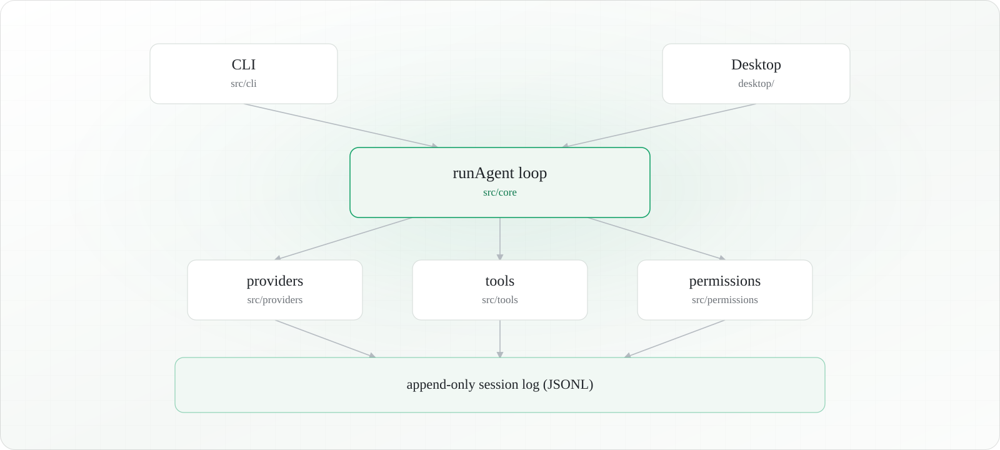
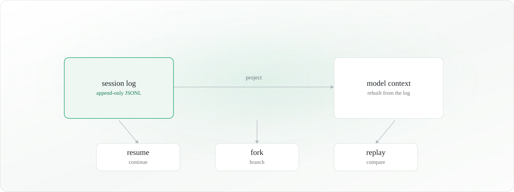
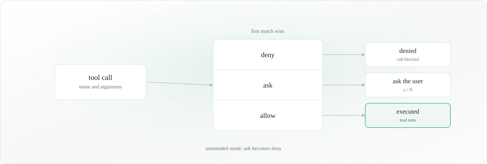
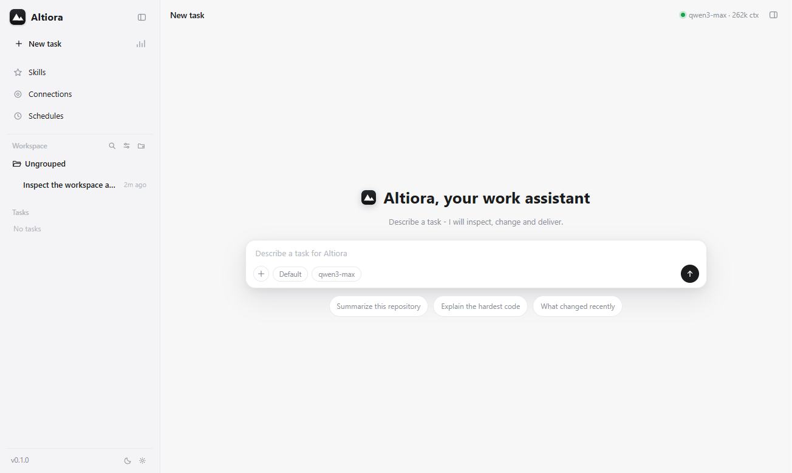
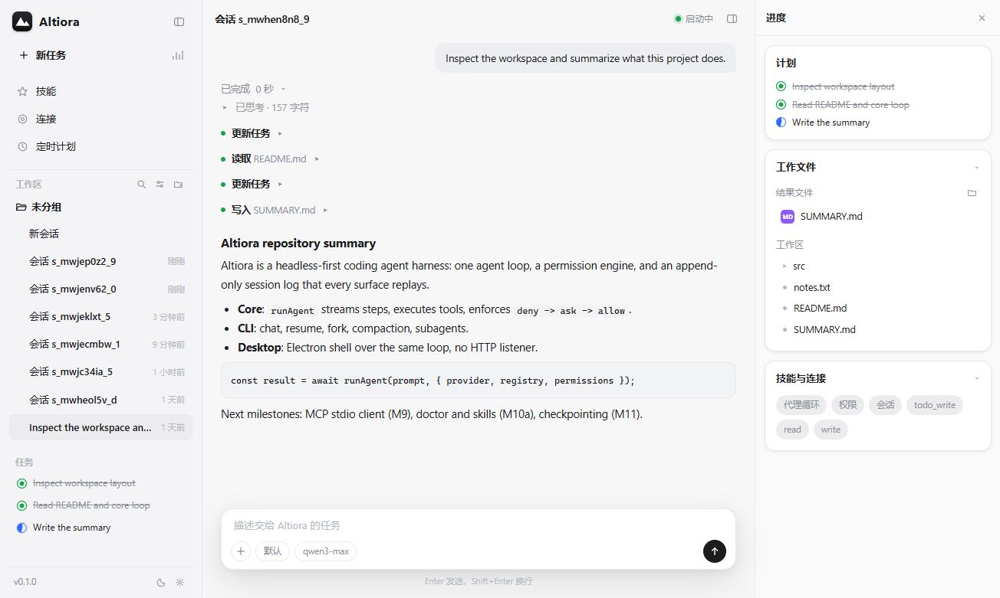
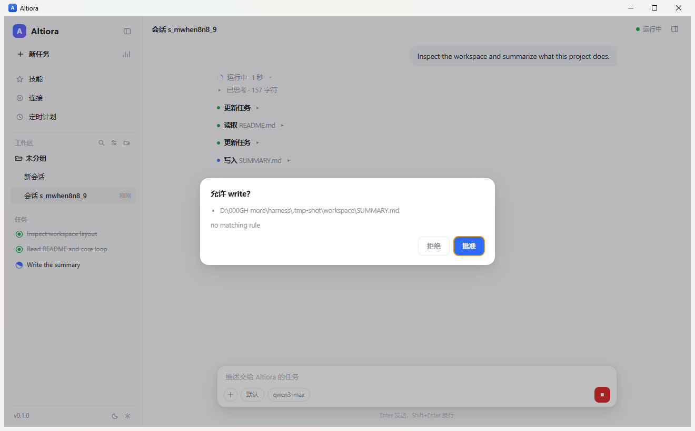
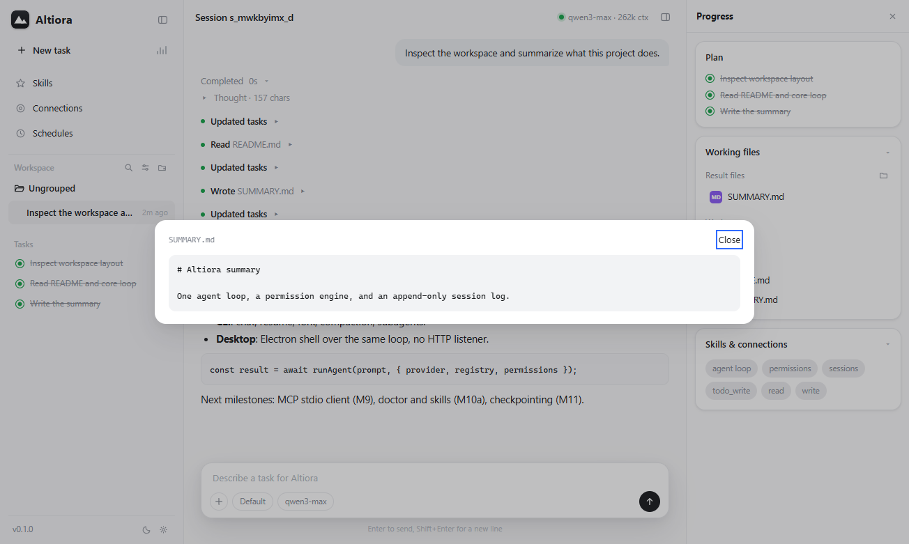

<div align="center">
  <picture>
    <source media="(prefers-color-scheme: dark)" srcset="docs/brand/hero-dark.svg">
    <source media="(prefers-color-scheme: light)" srcset="docs/brand/hero-light.svg">
    
  </picture>
</div>

<h1 align="center">Altiora</h1>

<p align="center"><em>ad altiora</em> — toward higher things.</p>

<p align="center">A headless-first coding agent harness with a CLI and a Windows desktop app.</p>

<p align="center">
  <a href="https://www.npmjs.com/package/altiora-agent"></a>
  <a href="https://github.com/Escap1ng/altiora-agent/actions/workflows/ci.yml"></a>
  <a href="LICENSE"></a>
  <a href="package.json"></a>
  <a href="desktop/"></a>
</p>

<p align="center">
  English | <a href="README.zh-CN.md">简体中文</a>
</p>

<p align="center">
  <a href="#design">Design</a> ·
  <a href="#status">Status</a> ·
  <a href="#usage">Usage</a> ·
  <a href="#desktop-app">Desktop app</a> ·
  <a href="#development">Development</a> ·
  <a href="#roadmap">Roadmap</a>
</p>

---

Altiora runs a model against a real working directory: it streams a turn, executes tools, enforces permissions, and records everything in an append-only session log that can be resumed, forked, or replayed.

## Design

### Architecture

<div align="center">
  <picture>
    <source media="(prefers-color-scheme: dark)" srcset="docs/brand/architecture-dark.svg">
    <source media="(prefers-color-scheme: light)" srcset="docs/brand/architecture-light.svg">
    
  </picture>
</div>

`runAgent` takes a provider, a tool registry, the permission engine and a log sink. It appends each turn, attempt, tool call, permission decision and result as it goes, and emits `RunEvent` objects. The CLI renderers and the desktop window consume those events; nothing in the core writes to stdout. Model context is projected from the log, so resume, fork and replay all read the same file.

Imports enforce the boundaries: `src/core` never imports `src/providers` or `src/cli`, wire formats stay in the provider adapter, and the desktop shell imports the built core and runs the same loop inside the Electron main process. There is no HTTP listener between the window and the loop.

<div align="center">
  <picture>
    <source media="(prefers-color-scheme: dark)" srcset="docs/brand/log-dark.svg">
    <source media="(prefers-color-scheme: light)" srcset="docs/brand/log-light.svg">
    
  </picture>
</div>

The log is the only source of truth. Model context is rebuilt from it every turn, and resume, fork and replay are three views over the same file.

### Principles

- **The session log is the source of truth.** Model context is projected from it, so resume, fork, replay, and crash recovery all come from the same data. Interrupted tool calls are settled on resume instead of being silently dropped.
- **Permissions are enforced by the harness, not requested in the prompt.** Rules use `deny -> ask -> allow` with first-match semantics. Headless runs have an explicit `unattended` policy where `ask` becomes `deny`.
- **Provider differences stay at the edge.** The core speaks semantic messages; OpenAI-compatible wire formats, `reasoning_content` round-tripping, and tool-call chunk assembly live in one adapter.
- **Small dependency surface.** Runtime dependencies are added only when they pay for themselves; tests use `node:test`; the CLI parses arguments with `node:util`.
- **Windows is a first-class platform.** Commands are spawned with argument arrays and never `shell: true`; path containment compares resolved paths with `path.relative`.

## Status

Current release: **0.1.0** on npm. The repository implements M0–M8 plus a schedules module, a redesigned desktop UI and the M9 MCP client (unreleased); the next scope is M10–M13.

Shipped:

- CLI through M7: streaming chat with tool activity, permission rules, JSONL sessions with resume and fork, AGENTS.md context, compaction, subagents, web fetch, `apply_patch`, `/stats` `/compress` `/model`, and context-window discovery.
- Desktop through M8: Electron shell with a session sidebar, workspace picker, file tree and read-only preview, streaming reasoning, and approval dialogs; both the executable and the installer carry the app icon.
- Schedules: a zero-dependency cron parser, a JSON store and a headless runner, exposed as `altiora schedule` and as a Schedules manager in the desktop sidebar.
- MCP (M9, unreleased): a zero-dependency stdio client that discovers external tools, exposes them as `mcp_<server>_<tool>` under the same permission rules, and isolates server failures.
- Desktop UI refresh: Simplified Chinese by default with English in Settings, a bilingual home screen whose composer sinks on the first send, a docked progress panel (plan, working files, skills), a workspace list with folder open/close animation, session titles derived from the log, and runtime permission-mode switching.
- `altiora-agent@0.1.0` is published on npm; the command is `altiora`.

Verification: `npm test` runs the unit tests plus end-to-end tests against a mock OpenAI-compatible server, and `npm run lint`, `npm run typecheck` and `npm run build` gate the tree. The desktop package has its own tests for the agent service, and the NSIS installer has been installed and uninstalled silently on Windows. CI runs both packages on ubuntu, macOS and Windows across Node 22 and 24, including the desktop build, typecheck and tests.

Known limits:

- The installer is unsigned, so SmartScreen warns on first run.
- Skills, hooks and checkpointing are not implemented yet; they are M10–M11. The MCP client is tools-only: resources, prompts, sampling and HTTP/SSE transports are out of scope.
- Only the OpenAI-compatible provider is implemented; native Anthropic and Gemini adapters are not.
- The desktop app targets Windows today, and there is no browser UI.
- The desktop UI is localized (Chinese and English); CLI output stays English by convention.
- Scheduled tasks run unattended, so a write without a matching `--allow` rule is denied rather than queued for approval.

## Requirements

Node.js 22.18 or newer. Development runs TypeScript directly through Node's type stripping, so no build step is needed to try the CLI.

## Usage

```sh
export ALTIORA_API_KEY=...
altiora run "summarize this repository" --model deepseek-chat --base-url https://api.deepseek.com/v1
```

Writing files and running commands requires an explicit rule:

```sh
altiora run "fix the failing test" --model deepseek-chat \
  --allow read --allow glob --allow grep \
  --allow "edit(src/**)" --allow "bash(node --test *)"
```

Rules use `tool(pattern)` syntax and are evaluated deny first, then ask, then allow. Read-only tools are allowed by default; `--permission-mode unattended` turns every unmatched `ask` into `deny`, and `--permission-mode plan` blocks all writes. Paths are resolved and rejected when they leave the workspace.

<div align="center">
  <picture>
    <source media="(prefers-color-scheme: dark)" srcset="docs/brand/permissions-dark.svg">
    <source media="(prefers-color-scheme: light)" srcset="docs/brand/permissions-light.svg">
    
  </picture>
</div>

`task` runs a subagent with a fresh context and a tool set without `task` itself, so subagents cannot nest. `webfetch` only accepts public http(s) URLs: loopback, private, link-local and metadata addresses are rejected, redirects are re-checked, and responses are capped at 5 MB.

`altiora init` writes `.altiora/config.json` and an `AGENTS.md` stub for a new project.

For an interactive session, run `altiora chat --model deepseek-chat`. It keeps one session across turns, streams the answer, prints tool activity, and asks y/N whenever a rule resolves to `ask`; `/new` starts a fresh session, `/stats` prints token and tool counts, `/compress` summarizes the session on demand, `/model` switches models and re-discovers limits, and `/exit` quits. Ctrl+C during a turn aborts it without ending the session.

By default `contextWindow` is `"auto"`: the harness asks the provider's `/models` listing for the model's window and output cap once at startup, falls back to 128k when the listing has no answer, and skips the request entirely when config or `--context-window` sets a number. Compaction triggers at 85% of the resolved window.

`apply_patch` applies Codex-style `*** Begin Patch` updates across several files as one edit: every add, update, move and delete is validated in memory first, and a failed hunk leaves all files untouched. `edit` stays the tool for a single unique replacement.

Configuration resolves from CLI flags over `ALTIORA_*` environment variables over the project config in `.altiora/config.json` (only when trusted) over the user config printed by `altiora config path`.

Sessions are append-only JSONL files in the user data directory. Every turn, attempt, tool call, permission decision and tool result is recorded; model context is projected from that log, so interrupted tool calls are settled on resume.

```sh
altiora sessions list
altiora sessions show <id>
altiora run "keep going" --resume <id>
altiora run "try another approach" --fork <id>
```

For scripts, `--output-format json` prints one result object and `--output-format stream-json` prints NDJSON events (`system`, `assistant`, `user`, `result`) with a stable `session_id`.

Scheduled tasks live in `schedules.json` in the user data directory and run headless under the unattended policy (only allow-listed writes execute):

```sh
altiora schedule add nightly "0 3 * * *" "summarize the repo" --allow "write(docs/**)"
altiora schedule list
altiora schedule run-now <id>
altiora schedule watch
```

The desktop app runs the same scheduler in the background and exposes a Schedules manager in the sidebar.

### MCP servers

External tools come from MCP servers over stdio, spoken by a zero-dependency JSON-RPC client. Configure them in the user config or in `.altiora/config.json`:

```json
{
  "mcpServers": {
    "everything": {
      "command": "node",
      "args": ["D:/mcp/everything-server.js"]
    }
  }
}
```

Optional per-server fields: `env` (extra environment variables), `cwd` (working directory, resolved against the workspace when relative), `timeoutMs` (per-request hard timeout, default 30000) and `enabled` (set `false` to skip a server). Each server runs as one child process spawned with an argument array, never through a shell.

Tools are exposed as `mcp_<server>_<tool>` and follow the same permission rules as built-ins: an unmatched call asks in `default` mode and is denied in `plan` and `unattended`, and a server's `readOnlyHint` marks a tool read-only. Project-level servers load only when the project config is trusted (`--trust-project` or `permissions.trustProjectConfig`), because starting a server executes code.

A server that fails to start, crashes or times out is isolated: it is reported unavailable on stderr and the run continues without its tools. All servers are terminated when the run ends or is aborted, leaving no orphan processes.

## Desktop app

`desktop/` is an Electron shell over the same core. The agent loop runs in the main process and streams `RunEvent`s to the renderer over IPC; approvals round-trip through a modal, and the preload bridge exposes nothing beyond the channels the window uses. There is no HTTP listener.

The window opens on a bilingual home screen: a centered welcome line with the composer beneath it, which sinks to the bottom once the first turn starts. Each turn renders as a timeline with a live timer, collapsible reasoning, one row per tool call, and the answer as Markdown.

- **Sidebar**: new task, Skills and Connections entries, a Schedules manager, and a workspace list whose group row animates between a closed and an open folder. Session titles come from the first user message in the log; search filters them and the sort control toggles between recent and name.
- **Progress panel**: a docked column with plan, working files and skills cards. Result files are collected only after a write succeeds, and history replay rebuilds the plan, the file list and the used-tool chips.
- **Composer**: permission-mode chip cycles `default / plan / unattended` at runtime, and the model chip shows the active model and its context window.
- **Settings**: language (Chinese or English) and theme (light or dark), both persisted locally.

The scheduler starts with the app and stops on quit, so scheduled tasks fire while the window is open.

| Workflow | Command |
|---|---|
| Run the source CLI | `node src/cli/main.ts run "..."` |
| Run the built CLI | `altiora run "..."` |
| Start the desktop app | `cd desktop && npm install && npm run start` |
| Build the installer | `cd desktop && npm run package` |

`npm run package` rebuilds the core, copies its `dist` into the app, and writes an NSIS installer plus an unpacked build to `desktop/release/`. The installer is per-user, allows choosing the directory, and is unsigned, so Windows SmartScreen warns on first run. Installer art comes from `desktop/scripts/make-icons.py`, which needs Pillow and regenerates the ICO, header and sidebar bitmaps in `desktop/build/`. The mark is a charcoal rounded square with a white twin-peak glyph; the same glyph appears in the sidebar and on the home screen.

### Screenshots



The home screen: a bilingual welcome line, the composer centered beneath it, and suggestion chips. The composer sinks to the bottom once the first turn starts.



A finished turn: the timeline with reasoning and localized tool rows, the Markdown answer, and the progress panel showing the plan, result files and the workspace tree.



Tool calls that write files wait for explicit approval, and the dialog lists the exact paths.



The workspace tree opens files as a read-only preview.

## Project instructions and context

`AGENTS.md` files are loaded from the repository root down to the working directory, plus a global file in the config directory. A line that is just `@path` imports another file, up to four levels deep and only inside the repository; the combined text is capped at 48k characters.

Before each step the harness estimates the request size, calibrates the estimate against the provider's reported input tokens, and once the context passes 85% of the usable window it summarizes the older part into a fixed template, keeps the most recent tail verbatim, and records the compaction in the session log. The summary survives replay, so `sessions show` and resume see the same context the model saw.

## Development

```sh
npm install
node src/cli/main.ts --help
node src/cli/main.ts config path
npm test
npm run typecheck
npm run build
cd desktop && npm run typecheck && npm test
```

## Layout

| Path | Contents |
|---|---|
| `src/cli` | command entry points and output renderers |
| `src/core` | agent loop, context assembly, compaction, run events |
| `src/providers` | model adapters (OpenAI-compatible first) |
| `src/tools` | tool definitions and execution |
| `src/permissions` | permission rules and workspace containment |
| `src/session` | append-only JSONL log, projection, resume |
| `src/schedule` | cron parsing, schedule store, headless scheduler |
| `src/config` | schema, path resolution, AGENTS.md discovery |
| `desktop/src` | Electron main process, agent service, preload bridge |
| `desktop/renderer` | window markup, styles, renderer script and i18n strings |
| `desktop/scripts` | core copy and icon generation |
| `docs/brand` | README hero artwork |
| `docs/screenshots` | README screenshots, per UI language |

## Roadmap

The detailed plan, acceptance criteria and deferred items live in [docs/PLAN.md](docs/PLAN.md).

| Milestone | Target | Scope |
|---|---|---|
| M10a | CLI 0.3.0 | `altiora doctor` and skills |
| M10b | CLI 0.3.0 | Harness spec and library, hooks, input fingerprints |
| M11 | CLI 0.4.0 | Checkpointing and `/rewind` over the resources a tool declares |
| M12 | CLI 0.5.0 | Native Anthropic adapter, capability matrix, `altiora models`, mid-session model switching |
| M13 | desktop 0.3.0 | Session rename/pin/delete, workspace history, editable skills and connections panels, usage view |

The order is deliberate: MCP adds the largest pool of external tools, M10 turns the harness itself into versioned data that sessions can be compared against, and M11 adds the safety net for file writes. Pointer-based compaction is deferred until summary-based compaction shows measured context loss.

Already delivered ahead of the roadmap: the M9 MCP stdio client (unreleased), session search and sort in the sidebar, read-only Skills and Connections panels, and the schedules module.

### Explicit non-goals

- A browser UI or a local HTTP server; the desktop app talks to the loop over Electron IPC.
- A plugin-graph architecture; MCP, skills and hooks are planned to cover the same ground with less machinery.
- OS sandboxes, LSP servers, agent teams and computer use.
- Native Anthropic and Gemini wire formats until the OpenAI-compatible adapter stops being enough.

## License

Apache-2.0

Releasing is documented in [RELEASING.md](RELEASING.md).
