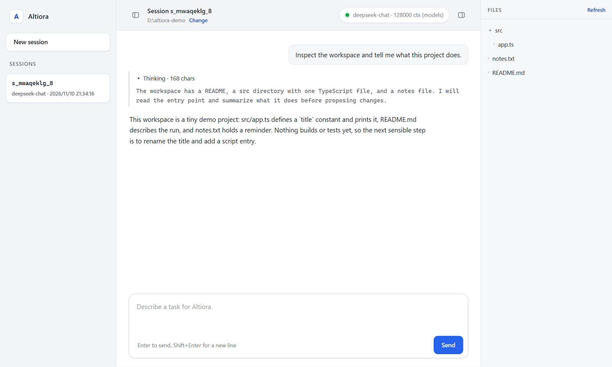
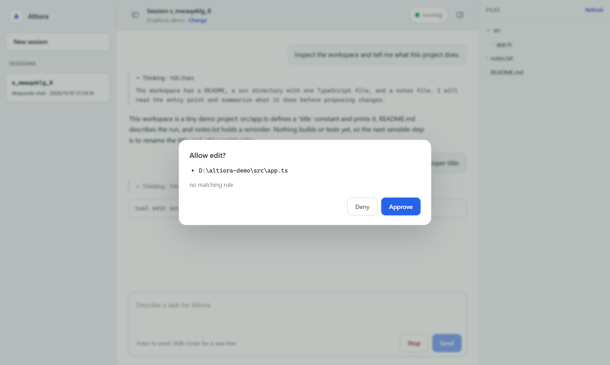
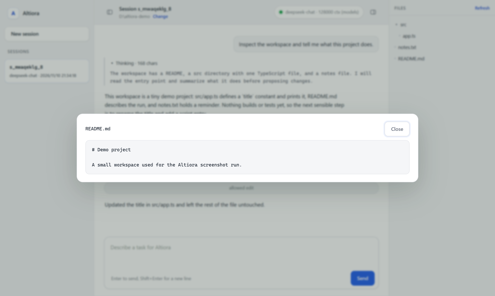

# Altiora

*ad altiora* - toward higher things.

A headless-first coding agent harness with a CLI and a Windows desktop app.

Altiora runs a model against a real working directory: it streams a turn, executes tools, enforces permissions, and records everything in an append-only session log that can be resumed, forked, or replayed.

Status: **0.1.0** on npm. The repository implements M0–M8; the next scope is M9–M11.

## Design

### Architecture

```
CLI (src/cli)                 Desktop (desktop/)
        \                      /
         runAgent loop (src/core)
          |        |        |
   providers     tools    permissions
          \        |        /
     append-only session log (JSONL)
```

`runAgent` takes a provider, a tool registry, the permission engine and a log sink. It appends each turn, attempt, tool call, permission decision and result as it goes, and emits `RunEvent` objects. The CLI renderers and the desktop window consume those events; nothing in the core writes to stdout. Model context is projected from the log, so resume, fork and replay all read the same file.

Imports enforce the boundaries: `src/core` never imports `src/providers` or `src/cli`, wire formats stay in the provider adapter, and the desktop shell imports the built core and runs the same loop inside the Electron main process. There is no HTTP listener between the window and the loop.

### Principles

- **The session log is the source of truth.** Model context is projected from it, so resume, fork, replay, and crash recovery all come from the same data. Interrupted tool calls are settled on resume instead of being silently dropped.
- **Permissions are enforced by the harness, not requested in the prompt.** Rules use `deny -> ask -> allow` with first-match semantics. Headless runs have an explicit `unattended` policy where `ask` becomes `deny`.
- **Provider differences stay at the edge.** The core speaks semantic messages; OpenAI-compatible wire formats, `reasoning_content` round-tripping, and tool-call chunk assembly live in one adapter.
- **Small dependency surface.** Runtime dependencies are added only when they pay for themselves; tests use `node:test`; the CLI parses arguments with `node:util`.
- **Windows is a first-class platform.** Commands are spawned with argument arrays and never `shell: true`; path containment compares resolved paths with `path.relative`.

## Status

Shipped:

- CLI through M7: streaming chat with tool activity, permission rules, JSONL sessions with resume and fork, AGENTS.md context, compaction, subagents, web fetch, `apply_patch`, `/stats` `/compress` `/model`, and context-window discovery.
- Desktop through M8: Electron shell with a session sidebar, workspace picker, file tree and read-only preview, streaming reasoning, and approval dialogs; both the executable and the installer carry the app icon.
- `altiora-agent@0.1.0` is published on npm; the command is `altiora`.

Verification: `npm test` runs the unit tests plus end-to-end tests against a mock OpenAI-compatible server, and `npm run lint`, `npm run typecheck` and `npm run build` gate the tree. The desktop package has its own tests for the agent service, and the NSIS installer has been installed and uninstalled silently on Windows.

Known limits:

- The installer is unsigned, so SmartScreen warns on first run.
- MCP servers, skills, hooks and checkpointing are not implemented yet; they are M9–M11.
- Only the OpenAI-compatible provider is implemented; native Anthropic and Gemini adapters are not.
- The desktop app targets Windows today, and there is no browser UI.

## Requirements

Node.js 22.18 or newer. Development runs TypeScript directly through Node's type stripping, so no build step is needed to try the CLI.

## Usage

```sh
export ALTIORA_API_KEY=...
altiora run "summarize this repository" --model deepseek-chat --base-url https://api.deepseek.com/v1
```

Writing files and running commands requires an explicit rule:

```sh
altiora run "fix the failing test" --model deepseek-chat \
  --allow read --allow glob --allow grep \
  --allow "edit(src/**)" --allow "bash(node --test *)"
```

Rules use `tool(pattern)` syntax and are evaluated deny first, then ask, then allow. Read-only tools are allowed by default; `--permission-mode unattended` turns every unmatched `ask` into `deny`, and `--permission-mode plan` blocks all writes. Paths are resolved and rejected when they leave the workspace.

`task` runs a subagent with a fresh context and a tool set without `task` itself, so subagents cannot nest. `webfetch` only accepts public http(s) URLs: loopback, private, link-local and metadata addresses are rejected, redirects are re-checked, and responses are capped at 5 MB.

`altiora init` writes `.altiora/config.json` and an `AGENTS.md` stub for a new project.

For an interactive session, run `altiora chat --model deepseek-chat`. It keeps one session across turns, streams the answer, prints tool activity, and asks y/N whenever a rule resolves to `ask`; `/new` starts a fresh session, `/stats` prints token and tool counts, `/compress` summarizes the session on demand, `/model` switches models and re-discovers limits, and `/exit` quits. Ctrl+C during a turn aborts it without ending the session.

By default `contextWindow` is `"auto"`: the harness asks the provider's `/models` listing for the model's window and output cap once at startup, falls back to 128k when the listing has no answer, and skips the request entirely when config or `--context-window` sets a number. Compaction triggers at 85% of the resolved window.

`apply_patch` applies Codex-style `*** Begin Patch` updates across several files as one edit: every add, update, move and delete is validated in memory first, and a failed hunk leaves all files untouched. `edit` stays the tool for a single unique replacement.

Configuration resolves from CLI flags over `ALTIORA_*` environment variables over the project config in `.altiora/config.json` (only when trusted) over the user config printed by `altiora config path`.

Sessions are append-only JSONL files in the user data directory. Every turn, attempt, tool call, permission decision and tool result is recorded; model context is projected from that log, so interrupted tool calls are settled on resume.

```sh
altiora sessions list
altiora sessions show <id>
altiora run "keep going" --resume <id>
altiora run "try another approach" --fork <id>
```

For scripts, `--output-format json` prints one result object and `--output-format stream-json` prints NDJSON events (`system`, `assistant`, `user`, `result`) with a stable `session_id`.

## Desktop app

`desktop/` is an Electron shell over the same core. The agent loop runs in the main process and streams `RunEvent`s to the renderer over IPC; approvals round-trip through a modal, and the preload bridge exposes nothing beyond the channels the window uses. There is no HTTP listener. The window has a collapsible session sidebar, a workspace picker, a file tree with a read-only preview, and renders reasoning separately from the answer.

| Workflow | Command |
|---|---|
| Run the source CLI | `node src/cli/main.ts run "..."` |
| Run the built CLI | `altiora run "..."` |
| Start the desktop app | `cd desktop && npm install && npm run start` |
| Build the installer | `cd desktop && npm run package` |

`npm run package` rebuilds the core, copies its `dist` into the app, and writes an NSIS installer plus an unpacked build to `desktop/release/`. The installer is per-user, allows choosing the directory, and is unsigned, so Windows SmartScreen warns on first run. Installer art comes from `desktop/scripts/make-icons.py`, which needs Pillow and regenerates the ICO, header and sidebar bitmaps in `desktop/build/`.

### Screenshots



Streaming answer, reasoning block and the collapsible file panel.



Tool calls that write files wait for explicit approval.



The workspace tree opens files as a read-only preview.

## Project instructions and context

`AGENTS.md` files are loaded from the repository root down to the working directory, plus a global file in the config directory. A line that is just `@path` imports another file, up to four levels deep and only inside the repository; the combined text is capped at 48k characters.

Before each step the harness estimates the request size, calibrates the estimate against the provider's reported input tokens, and once the context passes 85% of the usable window it summarizes the older part into a fixed template, keeps the most recent tail verbatim, and records the compaction in the session log. The summary survives replay, so `sessions show` and resume see the same context the model saw.

## Development

```sh
npm install
node src/cli/main.ts --help
node src/cli/main.ts config path
npm test
npm run typecheck
npm run build
cd desktop && npm run typecheck && npm test
```

## Layout

```
src/cli         command entry points and output renderers
src/core        agent loop, context assembly, compaction, run events
src/providers   model adapters (OpenAI-compatible first)
src/tools       tool definitions and execution
src/permissions permission rules and workspace containment
src/session     append-only JSONL log, projection, resume
src/config      schema, path resolution, AGENTS.md discovery
desktop/src     Electron main process, agent service, preload bridge
desktop/renderer  window markup, styles and renderer script
desktop/scripts   core copy and icon generation
```

## Roadmap

| Milestone | Target | Scope |
|---|---|---|
| M9 | CLI 0.3.0 | MCP stdio client: zero-dependency JSON-RPC over newline-delimited frames, tools only, trust-gated config, names exposed as `mcp_<server>_<tool>` |
| M10 | CLI 0.4.0 | Harness spec and library, skills, hooks, `altiora doctor`, pointer-based compaction, input fingerprints |
| M11 | CLI 0.5.0 | Checkpointing and `/rewind` over the resources a tool declares |

The order is deliberate: MCP adds the largest pool of external tools, M10 turns the harness itself into versioned data that sessions can be compared against, and M11 adds the safety net for file writes.

### Explicit non-goals

- A browser UI or a local HTTP server; the desktop app talks to the loop over Electron IPC.
- A plugin-graph architecture; MCP, skills and hooks are planned to cover the same ground with less machinery.
- OS sandboxes, LSP servers, agent teams and computer use.
- Native Anthropic and Gemini wire formats until the OpenAI-compatible adapter stops being enough.

## License

Apache-2.0

Releasing is documented in [RELEASING.md](RELEASING.md).
