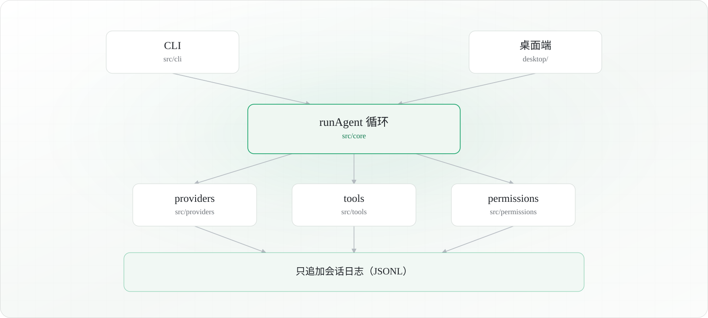
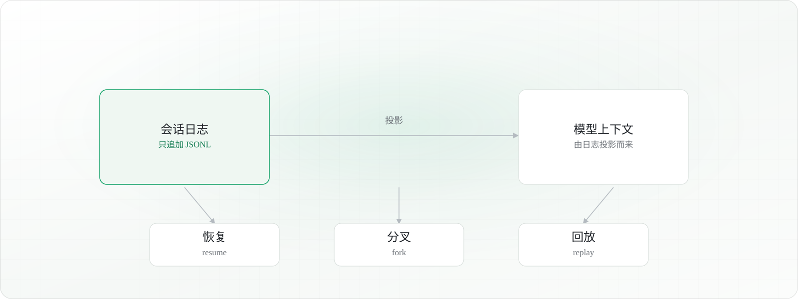
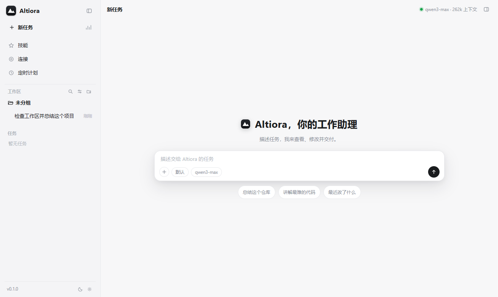
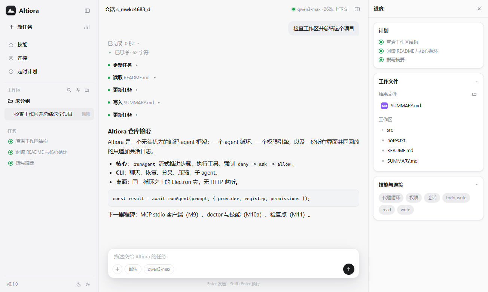
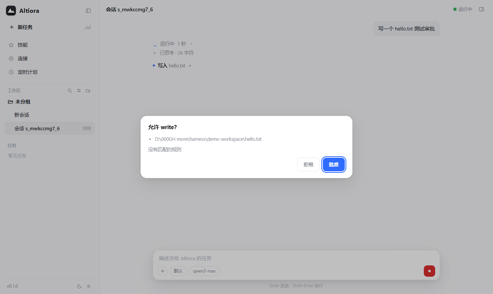
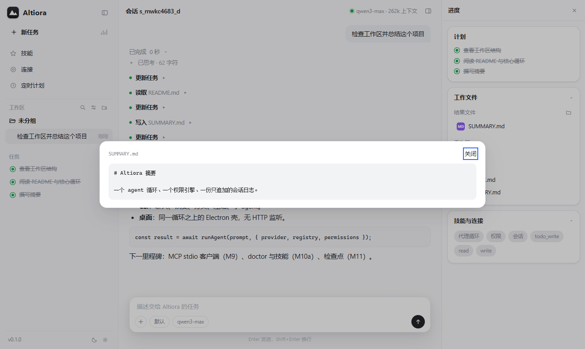

<div align="center">
  <picture>
    <source media="(prefers-color-scheme: dark)" srcset="docs/brand/hero-dark.svg">
    <source media="(prefers-color-scheme: light)" srcset="docs/brand/hero-light.svg">
    
  </picture>
</div>

<h1 align="center">Altiora</h1>

<p align="center"><em>ad altiora</em> —— 向更高处。</p>

<p align="center">无头优先的编码 agent 框架，提供命令行工具与 Windows 桌面应用。</p>

<p align="center">
  <a href="https://www.npmjs.com/package/altiora-agent"></a>
  <a href="https://github.com/Escap1ng/altiora-agent/actions/workflows/ci.yml"></a>
  <a href="LICENSE"></a>
  <a href="package.json"></a>
  <a href="desktop/"></a>
</p>

<p align="center">
  <a href="README.md">English</a> | 简体中文
</p>

<p align="center">
  <a href="#设计">设计</a> ·
  <a href="#状态">状态</a> ·
  <a href="#用法">用法</a> ·
  <a href="#桌面应用">桌面应用</a> ·
  <a href="#开发">开发</a> ·
  <a href="#路线图">路线图</a>
</p>

---

Altiora 让模型在真实工作目录中运行：流式推进一轮对话、执行工具、强制权限判定，并把全过程记录进只追加的会话日志，可随时恢复、分叉或回放。

## 设计

### 架构

<div align="center">
  <picture>
    <source media="(prefers-color-scheme: dark)" srcset="docs/brand/architecture-zh-dark.svg">
    <source media="(prefers-color-scheme: light)" srcset="docs/brand/architecture-zh-light.svg">
    
  </picture>
</div>

`runAgent` 接收 provider、工具注册表、权限引擎与日志写入端。它边运行边追加每一轮、每次尝试、每个工具调用、每次权限判定与结果，并发出 `RunEvent` 对象。CLI 渲染器与桌面窗口消费这些事件；核心层不向 stdout 写入任何内容。模型上下文由日志投影而来，因此恢复、分叉与回放读取的是同一份文件。

导入关系强制了边界：`src/core` 不导入 `src/providers` 或 `src/cli`，协议格式只留在 provider 适配器内，桌面壳导入构建后的核心并在 Electron 主进程里运行同一个循环。窗口与循环之间没有 HTTP 监听。

<div align="center">
  <picture>
    <source media="(prefers-color-scheme: dark)" srcset="docs/brand/log-zh-dark.svg">
    <source media="(prefers-color-scheme: light)" srcset="docs/brand/log-zh-light.svg">
    
  </picture>
</div>

日志是唯一事实源。模型上下文每一轮都由它重建，恢复、分叉与回放只是同一份文件的三种视图。

### 原则

- **会话日志是唯一事实源。** 模型上下文由它投影而来，恢复、分叉、回放与崩溃恢复都基于同一份数据。被中断的工具调用在恢复时结算，而不是被静默丢弃。
- **权限由框架强制，而不是在提示词里请求。** 规则按 `deny -> ask -> allow` 首次匹配生效。无头运行有显式的 `unattended` 策略，其中 `ask` 变为 `deny`。
- **provider 差异只留在边缘。** 核心层使用语义化消息；OpenAI 兼容协议格式、`reasoning_content` 往返与工具调用分片组装都集中在一个适配器里。
- **依赖面尽量小。** 只有当运行时依赖能抵得上自身成本时才引入；测试用 `node:test`；CLI 用 `node:util` 解析参数。
- **Windows 是一等平台。** 命令以参数数组启动，绝不使用 `shell: true`；路径归属用 `path.relative` 比较解析后的路径。

## 状态

当前发布：**0.1.0** 已在 npm 上。仓库已实现 M0–M8，外加定时计划模块与改版后的桌面界面；下一阶段范围是 M9–M13。

已交付：

- CLI 至 M7：带工具活动的流式聊天、权限规则、支持恢复与分叉的 JSONL 会话、AGENTS.md 上下文、压缩、子 agent、网页抓取、`apply_patch`、`/stats` `/compress` `/model`，以及上下文窗口探测。
- 桌面端至 M8：Electron 壳，含会话侧栏、工作区选择、文件树与只读预览、流式思考过程与审批对话框；可执行文件与安装包都带应用图标。
- 定时计划：零依赖 cron 解析器、JSON 存储与无头执行器，通过 `altiora schedule` 与桌面侧栏的定时计划管理器暴露。
- 桌面界面改版：默认简体中文、英文收在设置中，双语首页且输入舱在首次发送后下沉，常驻进度面板（计划、工作文件、技能），带文件夹开合动画的工作区列表，从日志派生的会话标题，以及运行时权限模式切换。
- `altiora-agent@0.1.0` 已发布到 npm，命令名为 `altiora`。

验证：`npm test` 运行单元测试与针对模拟 OpenAI 兼容服务的端到端测试，`npm run lint`、`npm run typecheck` 与 `npm run build` 作为门禁。桌面包有独立的 agent 服务测试，NSIS 安装包已在 Windows 上完成静默安装与卸载验证。CI 在 ubuntu、macOS 与 Windows 上跨 Node 22 与 24 运行两个包，包含桌面构建、类型检查与测试。

已知限制：

- 安装包未签名，首次运行会触发 SmartScreen 提示。
- MCP 服务、技能、hooks 与检查点尚未实现，属于 M9–M11。
- 仅实现 OpenAI 兼容 provider，原生 Anthropic 与 Gemini 适配器尚未提供。
- 桌面应用目前面向 Windows，没有浏览器界面。
- 桌面界面已本地化（中文与英文）；按约定 CLI 输出保持英文。
- 定时任务无人值守运行，因此没有匹配 `--allow` 规则的写入会被直接拒绝，而不是排队等待批准。

## 环境要求

Node.js 22.18 或更新版本。开发时由 Node 的类型剥离直接运行 TypeScript，试用 CLI 无需构建步骤。

## 用法

```sh
export ALTIORA_API_KEY=...
altiora run "summarize this repository" --model deepseek-chat --base-url https://api.deepseek.com/v1
```

写文件与执行命令需要显式规则：

```sh
altiora run "fix the failing test" --model deepseek-chat \
  --allow read --allow glob --allow grep \
  --allow "edit(src/**)" --allow "bash(node --test *)"
```

规则使用 `tool(pattern)` 语法，按 deny、ask、allow 的顺序判定。只读工具默认允许；`--permission-mode unattended` 把所有未匹配的 `ask` 变为 `deny`，`--permission-mode plan` 阻止一切写入。路径会被解析，越出工作区即拒绝。

<div align="center">
  <picture>
    <source media="(prefers-color-scheme: dark)" srcset="docs/brand/permissions-zh-dark.svg">
    <source media="(prefers-color-scheme: light)" srcset="docs/brand/permissions-zh-light.svg">
    
  </picture>
</div>

`task` 以全新上下文运行子 agent，其工具集不含 `task` 本身，因此子 agent 不能嵌套。`webfetch` 只接受公网 http(s) URL：回环、私有、链路本地与元数据地址一律拒绝，重定向会重新校验，响应上限 5 MB。

`altiora init` 为新项目写入 `.altiora/config.json` 与 `AGENTS.md` 骨架。

交互式会话运行 `altiora chat --model deepseek-chat`。它跨轮保持同一会话、流式输出回答、打印工具活动，并在规则判定为 `ask` 时询问 y/N；`/new` 开启新会话，`/stats` 打印 token 与工具计数，`/compress` 按需压缩会话，`/model` 切换模型并重新探测限制，`/exit` 退出。一轮进行中按 Ctrl+C 只中止该轮，不结束会话。

`contextWindow` 默认为 `"auto"`：启动时向 provider 的 `/models` 列表询问该模型的窗口与输出上限一次，列表无答案时回退到 128k，若配置或 `--context-window` 已给出数值则完全跳过该请求。压缩在解析后窗口的 85% 处触发。

`apply_patch` 把 Codex 风格的 `*** Begin Patch` 更新作为一次编辑跨多个文件应用：每个新增、更新、移动与删除都先在内存中校验，任一 hunk 失败则所有文件保持原样。`edit` 仍是单次唯一替换的工具。

配置优先级为：CLI 参数 > `ALTIORA_*` 环境变量 > `.altiora/config.json` 中的项目配置（仅在受信任时）> `altiora config path` 打印的用户配置。

会话是用户数据目录下的只追加 JSONL 文件。每一轮、每次尝试、每个工具调用、每次权限判定与工具结果都会被记录；模型上下文由该日志投影，因此被中断的工具调用会在恢复时结算。

```sh
altiora sessions list
altiora sessions show <id>
altiora run "keep going" --resume <id>
altiora run "try another approach" --fork <id>
```

面向脚本时，`--output-format json` 打印单个结果对象，`--output-format stream-json` 打印 NDJSON 事件（`system`、`assistant`、`user`、`result`），并带稳定的 `session_id`。

定时任务存放在用户数据目录的 `schedules.json`，以无人值守策略无头运行（仅执行允许清单内的写入）：

```sh
altiora schedule add nightly "0 3 * * *" "summarize the repo" --allow "write(docs/**)"
altiora schedule list
altiora schedule run-now <id>
altiora schedule watch
```

桌面应用在后台运行同一个调度器，并在侧栏提供定时计划管理器。

## 桌面应用

`desktop/` 是同一核心之上的 Electron 壳。agent 循环运行在主进程，通过 IPC 向渲染层流式推送 `RunEvent`；审批经模态框往返，preload 桥只暴露窗口实际使用的通道。没有 HTTP 监听。

窗口打开在双语首页：居中的欢迎语与下方输入舱，首轮开始后输入舱下沉到底部。每一轮渲染为时间线，带实时计时、可折叠的思考过程、每个工具调用一行，回答以 Markdown 呈现。

- **侧栏**：新任务、技能与连接入口、定时计划管理器，以及分组行在闭合与展开文件夹之间动画切换的工作区列表。会话标题取自日志中的首条用户消息；搜索可过滤，排序控件在最近与名称之间切换。
- **进度面板**：常驻列，含计划、工作文件与技能三张卡片。结果文件仅在写入成功后收集，历史回放会重建计划、文件列表与已用工具标签。
- **输入舱**：权限模式标签在运行时循环 `default / plan / unattended`，模型标签显示当前模型及其上下文窗口。
- **设置**：语言（中文或英文）与主题（浅色或深色），均在本地持久化。

调度器随应用启动、退出时停止，因此窗口打开期间定时任务会照常触发。

| 场景 | 命令 |
|---|---|
| 运行源码 CLI | `node src/cli/main.ts run "..."` |
| 运行构建后 CLI | `altiora run "..."` |
| 启动桌面应用 | `cd desktop && npm install && npm run start` |
| 构建安装包 | `cd desktop && npm run package` |

`npm run package` 会重新构建核心、把其 `dist` 拷入应用，并在 `desktop/release/` 生成 NSIS 安装包与免安装版本。安装包按用户安装、允许选择目录，且未签名，首次运行会触发 Windows SmartScreen 提示。安装器美术资源来自 `desktop/scripts/make-icons.py`，需要 Pillow，会重新生成 `desktop/build/` 下的 ICO、头图与侧图。标识是炭黑圆角方块配白色双峰图形，同一图形也出现在侧栏与首页。

### 界面截图

以下为中文界面；英文界面截图见 [English README](README.md#screenshots)。



首页：欢迎语居中，输入舱在其下方，再往下是建议标签。首轮开始后输入舱下沉到底部。



完成的一轮：带思考过程与本地化工具行的时间线、Markdown 回答，以及展示计划、结果文件与工作区树的进度面板。



写文件的工具调用会等待显式批准，对话框列出确切路径与判定原因。



工作区树以只读预览方式打开文件。

## 项目指令与上下文

`AGENTS.md` 从仓库根目录逐级加载到工作目录，另加配置目录中的全局文件。仅含 `@path` 的行会导入另一个文件，最多四层且只允许在仓库内部；合并后的文本上限为 48k 字符。

每一步之前，框架会估算请求大小、用 provider 报告的输入 token 校准估算值；一旦上下文超过可用窗口的 85%，就把较早部分按固定模板摘要、逐字保留最近的尾部，并把这次压缩记入会话日志。摘要在回放中保留，因此 `sessions show` 与恢复看到的上下文与模型当时看到的一致。

## 开发

```sh
npm install
node src/cli/main.ts --help
node src/cli/main.ts config path
npm test
npm run typecheck
npm run build
cd desktop && npm run typecheck && npm test
```

## 目录结构

| 路径 | 内容 |
|---|---|
| `src/cli` | 命令入口与输出渲染器 |
| `src/core` | agent 循环、上下文组装、压缩、运行事件 |
| `src/providers` | 模型适配器（先做 OpenAI 兼容） |
| `src/tools` | 工具定义与执行 |
| `src/permissions` | 权限规则与工作区归属 |
| `src/session` | 只追加 JSONL 日志、投影、恢复 |
| `src/schedule` | cron 解析、计划存储、无头调度器 |
| `src/config` | schema、路径解析、AGENTS.md 发现 |
| `desktop/src` | Electron 主进程、agent 服务、preload 桥 |
| `desktop/renderer` | 窗口结构、样式、渲染脚本与语言包 |
| `desktop/scripts` | 核心拷贝与图标生成 |
| `docs/brand` | README 首图素材 |
| `docs/screenshots` | README 截图，按界面语言分目录 |

## 路线图

详细计划、验收标准与推迟项见 [docs/PLAN.md](docs/PLAN.md)。

| 里程碑 | 目标版本 | 范围 |
|---|---|---|
| M9 | CLI 0.2.0 | MCP stdio 客户端：零依赖 JSON-RPC、按换行分帧，仅工具能力，配置受信任门禁，名称暴露为 `mcp_<server>_<tool>` |
| M10a | CLI 0.3.0 | `altiora doctor` 与技能 |
| M10b | CLI 0.3.0 | harness 规格与库、hooks、输入指纹 |
| M11 | CLI 0.4.0 | 基于工具声明资源的检查点与 `/rewind` |
| M12 | CLI 0.5.0 | 原生 Anthropic 适配器、能力矩阵、`altiora models`、会话中切换模型 |
| M13 | desktop 0.3.0 | 会话重命名/置顶/删除、工作区历史、可编辑的技能与连接面板、用量视图 |

顺序是刻意的：MCP 带来最大的外部工具池，M10 把 harness 自身变成可比对的版本化数据，M11 为文件写入补上安全网。指针式压缩推迟到基于摘要的压缩出现实测上下文丢失之后再做。

已提前于路线图交付：侧栏会话搜索与排序、只读的技能与连接面板，以及定时计划模块。

### 明确的非目标

- 浏览器界面或本地 HTTP 服务；桌面应用通过 Electron IPC 与循环通信。
- 插件图架构；MCP、技能与 hooks 计划以更少的机制覆盖同样的需求。
- 操作系统沙箱、LSP 服务、agent 团队与计算机操作。
- 在 OpenAI 兼容适配器够用之前，不做原生 Anthropic 与 Gemini 协议格式。

## 许可

Apache-2.0

发布流程见 [RELEASING.md](RELEASING.md)。
